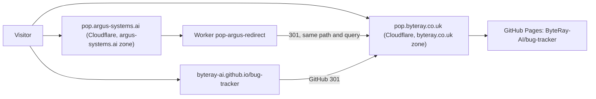

# PoP Hosting and Deployment

This runbook covers how requests reach `pop.byteray.co.uk`, where each setting
lives, what every publish checks, and how to recover when something breaks.
Authoring rules are in `ADVISORY_AUTHORING.md`.

## How requests are served



- `pop.byteray.co.uk` is the only origin. Cloudflare proxies it directly to
  GitHub Pages, whose custom domain is `pop.byteray.co.uk`, and terminates TLS.
- `pop.argus-systems.ai` is retired. The `pop-argus-redirect` Worker answers
  every request on it with a 301 to the same path and query on
  `pop.byteray.co.uk`, so links published with the old domain keep working.
- Every page declares its `pop.byteray.co.uk` URL as canonical.

## Where each setting lives

| Setting | Location | Required value |
| --- | --- | --- |
| Build origin (`SITEURL`) | `.github/workflows/publish.yml`; default in `publishconf.py` | `https://pop.byteray.co.uk` |
| Pages custom domain | GitHub repository Settings > Pages | `pop.byteray.co.uk` |
| `pop` DNS record, byteray.co.uk | Cloudflare > byteray.co.uk > DNS | CNAME `byteray-ai.github.io`, Proxied |
| SSL/TLS encryption mode, byteray.co.uk | Cloudflare > byteray.co.uk > SSL/TLS | Full or Flexible, not Full (strict) |
| HTTP to HTTPS upgrade for `pop` | Cloudflare > byteray.co.uk | On |
| Redirect Worker and its route | `infra/cloudflare/pop-argus-redirect/` | Route `pop.argus-systems.ai/*` |
| `pop` DNS record, argus-systems.ai | Cloudflare > argus-systems.ai > DNS | Any proxied record; the Worker answers first |

A repository variable named `SITEURL` overrides the build origin, but the
verifier only accepts `https://pop.byteray.co.uk`, so changing the domain means
changing the code too.

Full (strict) fails with Cloudflare error 526: GitHub cannot issue a
certificate for a hostname that Cloudflare proxies, so it presents its
`*.github.io` certificate. For the same reason, the repository's Pages settings
show a DNS warning and "Enforce HTTPS" stays unavailable. Both are expected.

## Publishing

A push to `main` runs `.github/workflows/publish.yml`:

1. `scripts/validate_advisories.py` checks identifiers, metadata, and embargo
   boundaries, and prints the numbers the home page will show.
2. A guard reads the Pages custom domain from the GitHub API and stops the run
   unless it equals the host of `SITEURL`.
3. Pelican builds the site with `publishconf.py`.
4. `scripts/verify_site.py` checks the build:
   - every advisory has a page, and no page lacks a source file;
   - the hero numbers and column counts on every `index*.html` page equal the
     numbers computed from the advisory files;
   - every page's canonical link and every feed link and id use `SITEURL`;
   - no HTML or XML file mentions `pop.argus-systems.ai`.
5. Only then is the site uploaded and deployed.

Run steps 1, 3, and 4 locally with the three commands in section 9 of
`ADVISORY_AUTHORING.md`, or with `make publish verify` in an activated virtual
environment.

If the guard fails, the GitHub Pages custom domain and `SITEURL` disagree. Set
the custom domain back to `pop.byteray.co.uk`; do not change `SITEURL` to match
a wrong domain.

After a deploy, GitHub's CDN and browsers can serve the previous version of a
page for up to 10 minutes (`Cache-Control: max-age=600`). The CI verification
is authoritative.

## Changing the redirect Worker

```bash
cd infra/cloudflare/pop-argus-redirect
npm ci
npm test
npx wrangler deploy
```

`wrangler deploy` needs a Wrangler login for the Cloudflare account that owns
the `argus-systems.ai` zone. Deployment is manual; no Cloudflare credentials are
stored in GitHub.

## Checking production

```bash
# 200, served by GitHub Pages (x-github-request-id), no x-content-source header
curl -sI https://pop.byteray.co.uk/advisory/adv-038.html

# 301 to https://pop.byteray.co.uk/advisory/BYTERAY-2026-0220.html?x=1
curl -sI 'https://pop.argus-systems.ai/advisory/BYTERAY-2026-0220.html?x=1'

# Redirect to https://pop.byteray.co.uk/
curl -sI http://pop.byteray.co.uk/
curl -sIL https://byteray-ai.github.io/bug-tracker/ | grep -i '^location'

# pop.byteray.co.uk
gh api repos/ByteRay-AI/bug-tracker/pages --jq .cname
```

## Troubleshooting

| Symptom on `pop.byteray.co.uk` | Likely cause | Fix |
| --- | --- | --- |
| 404 "Site not found · GitHub Pages" | Pages custom domain changed or removed | Set it back to `pop.byteray.co.uk` |
| Cloudflare error 522 | `pop` DNS record no longer points to GitHub | Restore CNAME `byteray-ai.github.io`, Proxied |
| Cloudflare error 526 | SSL/TLS mode set to Full (strict) | Use Full |
| Redirect loop | Something proxies `pop.byteray.co.uk` to `pop.argus-systems.ai` again | Remove that proxy |
| Deploy stopped at the domain guard | Pages custom domain is not `pop.byteray.co.uk` | Fix the custom domain |

The custom domain can be restored in the repository's Pages settings or with:

```bash
gh api -X PUT repos/ByteRay-AI/bug-tracker/pages -f cname=pop.byteray.co.uk
```

## Domain migration of 2026-10-14

Before this migration the roles were reversed. GitHub Pages served
`pop.argus-systems.ai`, every build linked to it, and a Worker named
`pop-byteray-proxy` on `pop.byteray.co.uk/*` fetched each page from
`pop.argus-systems.ai` and rewrote the hostname in the response. Visitors who
arrived any other way, including through GitHub's own redirect, stayed on the
argus domain.

### Cutover order

Three switches decide where traffic goes: the Pages custom domain, the proxy
route on `pop.byteray.co.uk/*`, and the redirect route on
`pop.argus-systems.ai/*`. The order matters:

1. Point the `pop.byteray.co.uk` DNS record at GitHub (CNAME
   `byteray-ai.github.io`, Proxied). This is harmless while the proxy route
   exists. Edit the record in place; the zone caches "name not found" answers
   for 30 minutes.
2. Deploy a build with `SITEURL=https://pop.byteray.co.uk`, without the domain
   guard. Both hostnames then serve pages that link to `pop.byteray.co.uk`.
3. Upload the redirect Worker without its route.
4. Switch the Pages custom domain to `pop.byteray.co.uk`.
5. Wait until GitHub serves the new hostname, probing a never-used path
   directly against GitHub's IP addresses. Removing the proxy earlier would let
   Cloudflare cache GitHub's "Site not found" responses for stylesheets and
   images.
6. Delete the proxy route, then attach the redirect route. Never let both
   routes be active at once: the proxy would fetch the redirect, and the two
   hostnames would send visitors back and forth.
7. Add the domain guard to the workflow and deploy again.
8. Delete the `pop-byteray-proxy` Worker once the production checks pass.

Steps 4 to 6 cause a short outage on both hostnames, because the proxy depends
on GitHub serving `pop.argus-systems.ai`.

### Rollback

Until step 8, the old arrangement can be restored in this order: detach the
redirect route, set the Pages custom domain back to `pop.argus-systems.ai`,
then recreate the route `pop.byteray.co.uk/*` for `pop-byteray-proxy`. After
step 8, restoring it would require a new proxy Worker; fix forward instead.
